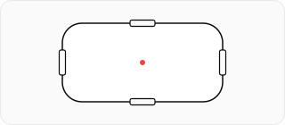
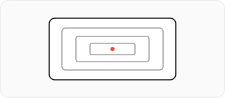
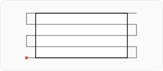
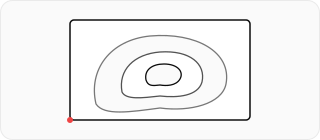

<div align="center">

<a href="https://flandolt.github.io/gsender-plugins/"><picture>
<source media="(prefers-color-scheme: dark)" srcset=".github/readme/logo-dark.svg">

</picture></a>

# Plugins for gSender

**Small, free plugins that turn a few numbers into clean, GRBL-safe G-code, with a live 3D preview.**<br>
No CAM software needed.

<a href="https://flandolt.github.io/gsender-plugins/"></a>
&nbsp;
<a href="https://github.com/FLandolt/gsender-plugins/releases"></a>

<a href="https://github.com/FLandolt/gsender-plugins/actions/workflows/pages.yml"></a>
<a href="https://github.com/FLandolt/gsender-plugins/actions/workflows/auto-release.yml"></a>
<a href="https://github.com/Sienci-Labs/gsender"></a>
<a href="https://github.com/gnea/grbl"></a>
<a href="https://github.com/grblHAL/core"></a>
<a href="https://nodejs.org/"></a>
<a href="https://github.com/FLandolt/gsender-plugins/issues"></a>
<a href="https://claude.com/claude-code"></a>

[Plugins](#plugins) · [Install](#install) · [Develop](#develop) · [Releasing](#releasing) · [Support](#support)

</div>

> [!WARNING]
> **Always check before you cut.** Look at the toolpath preview, run the job in the air first, and keep a hand on the stop button. You use these plugins at your own risk.

## Plugins

<table>
<tr>
<td width="50%" valign="top">

<a href="plugins/hole-pattern"><picture>
<source media="(prefers-color-scheme: dark)" srcset=".github/readme/holes-dark.svg">

</picture></a>

**[Hole Pattern](plugins/hole-pattern)**<br>
One hole or a grid of holes. The bit spirals down level by level, with arcs or short chords.

[Docs](plugins/hole-pattern) · [Live demo](https://flandolt.github.io/gsender-plugins/demos/hole-pattern/) · [Download](https://github.com/FLandolt/gsender-plugins/releases?q=hole-pattern-v&expanded=true)

</td>
<td width="50%" valign="top">

<a href="plugins/cutout"><picture>
<source media="(prefers-color-scheme: dark)" srcset=".github/readme/rect-dark.svg">

</picture></a>

**[Cutout](plugins/cutout)**<br>
Cut a rectangle, a circle or the outline of a picture, inside or outside the line, with rounded corners and holding tabs.

[Docs](plugins/cutout) · [Live demo](https://flandolt.github.io/gsender-plugins/demos/cutout/) · [Download](https://github.com/FLandolt/gsender-plugins/releases?q=cutout-v&expanded=true)

</td>
</tr>
<tr>
<td width="50%" valign="top">

<a href="plugins/pocket-cutout"><picture>
<source media="(prefers-color-scheme: dark)" srcset=".github/readme/pocket-dark.svg">

</picture></a>

**[Pocket Cutout](plugins/pocket-cutout)**<br>
Clear a rectangular, round or picture-shaped pocket in a spiral from the middle outwards, with no plunging.

[Docs](plugins/pocket-cutout) · [Live demo](https://flandolt.github.io/gsender-plugins/demos/pocket-cutout/) · [Download](https://github.com/FLandolt/gsender-plugins/releases?q=pocket-cutout-v&expanded=true)

</td>
<td width="50%" valign="top">

<a href="plugins/vcarve"><picture>
<source media="(prefers-color-scheme: dark)" srcset=".github/readme/vcarve-dark.svg">

</picture></a>

**[V-Carve](plugins/vcarve)**<br>
Carve text, SVG shapes and pictures with a V-bit: deep where the shape is wide, sharp at the corners.

[Docs](plugins/vcarve) · [Live demo](https://flandolt.github.io/gsender-plugins/demos/vcarve/) · [Download](https://github.com/FLandolt/gsender-plugins/releases?q=vcarve-v&expanded=true)

</td>
</tr>
<tr>
<td width="50%" valign="top">

<a href="plugins/surfacing"><picture>
<source media="(prefers-color-scheme: dark)" srcset=".github/readme/surface-dark.svg">

</picture></a>

**[Surfacing](plugins/surfacing)**<br>
Face a rectangular area. Choose the start corner, direction and how the passes turn.

[Docs](plugins/surfacing) · [Live demo](https://flandolt.github.io/gsender-plugins/demos/surfacing/) · [Download](https://github.com/FLandolt/gsender-plugins/releases?q=surfacing-v&expanded=true)

</td>
<td width="50%" valign="top">

<a href="plugins/heightmap"><picture>
<source media="(prefers-color-scheme: dark)" srcset=".github/readme/heightmap-dark.svg">

</picture></a>

**[Height Map](plugins/heightmap)**<br>
Carve a picture or height map into stepped levels, like a contour model: dark goes deep, light stays on top.

[Docs](plugins/heightmap) · [Live demo](https://flandolt.github.io/gsender-plugins/demos/heightmap/) · [Download](https://github.com/FLandolt/gsender-plugins/releases?q=heightmap-v&expanded=true)

</td>
</tr>
</table>

All plugins:

- Write `G0`/`G1` moves and, where the shape has circles or rounded corners, by default `G2`/`G3` arcs (V-Carve and Height Map write straight moves only) (smaller files, smoother motion). Pick **Lines (G1)** under *More options* to get short `G1` chords instead. No canned cycles and no cutter compensation, so the output runs on GRBL 1.1 and grblHAL.
- Show a 3D toolpath preview using gSender's own viewer, with the bit drawn at your tool diameter. Switch the preview to **Material** to run the viewer's cut simulation and see what is left of a block of stock, so any uncut area stands out.
- Walk you through the settings in steps: tap a step's tab to jump straight to it. A red dot marks a step that still needs something, and the last step sums up the job before you load it.
- Keep the preview on screen all the time: beside the settings on a landscape screen, below them on a portrait (9:16) or narrow one. Only the settings scroll.
- Draw what the numbers mean as you type them: the bit in its cut seen from the side (diameter, depth, one line per pass, safe Z), the stepover seen from above, and the holding tabs.
- Are made for touch screens: big buttons and sliders, and tapping a number box selects it so you can type over it. A box can be cleared completely before typing a new value (a comma works as the decimal mark too).
- Won't generate or load anything while a box is empty or a needed value is 0. The depth starts at 0 on purpose, so you always enter it for your stock; the bit starts at 4 mm.
- Keep the figures (size, levels or passes, estimated time), G-code and Load to gSender in one bar under the preview. Both panels keep their size, and problems and warnings float in a card over the corner of the preview, so nothing moves when they appear; fold it to a small pill with ×, and it opens again when the messages change.
- Offer **Slow**, **Medium** and **High** speed presets, or your own feed, plunge, spindle and stepdown values.
- Work in millimetres or inches.
- Load the program straight into gSender with **Load to gSender**.

You can try them all in your browser on the [website](https://flandolt.github.io/gsender-plugins/). In the demo, **Load to gSender** downloads the `.nc` file instead.

## Install

Requires gSender 1.6.0 or newer.

1. Download the zip of the plugin you want from the [Releases](https://github.com/FLandolt/gsender-plugins/releases) page. Leave it zipped.
2. In gSender, install a plugin and select the downloaded zip. gSender unpacks it for you.
3. Open the plugin from the tools page.

If you prefer, you can unzip it into gSender's `plugins` folder yourself, so you end up with `plugins/<name>/gsender-plugin.json`.

## Develop

Needs [Node.js](https://nodejs.org/) 20 or newer.

```bash
npm install                                      # once, at the repo root
npm run dev --workspace plugins/cutout      # run one plugin standalone, with a mocked gSender
npm test                                         # unit tests for all plugins
npm run check                                    # type-check all plugins
npm run build                                    # build all plugins to plugins/*/ui
```

Outside gSender the plugins talk to a small mock bridge ([`packages/shared/src/mockBridge.ts`](packages/shared/src/mockBridge.ts)), so you can work on them in a plain browser.

### Layout

```
plugins/<name>/     one gSender plugin each: its own manifest, source and build (ui/)
packages/shared/    code shared by the plugins: mock bridge, UI parts, 3D preview, G-code helpers
site/               the GitHub Pages website (plain HTML, no build step)
```

The website's live demos are built from the plugin sources by the [Pages workflow](.github/workflows/pages.yml) on every push to `main`.

## Releasing

Releases are automatic. On every push to `main` the [auto-release workflow](.github/workflows/auto-release.yml) looks at each plugin:

- If its code changed since its newest tag, it gets the next patch version (`cutout-v0.0.2` → `cutout-v0.0.3`): the plugin is tested, built and published as `<plugin>-<version>.zip` on a new GitHub release with that tag.
- If its newest tag has no release yet, that tag is released.
- Otherwise nothing happens. Changes to `packages/shared` count for every plugin; README edits don't.

The website's download buttons pick up the newest release automatically. To catch up by hand, open the workflow in the Actions tab and press **Run workflow**.

For a bigger version jump, tag it yourself, one tag per push (GitHub ignores tag pushes of more than three tags at once):

```bash
git tag cutout-v0.1.0
git push origin cutout-v0.1.0
```

The [release workflow](.github/workflows/release.yml) builds that tag, and later automatic releases count on from it.

## How this was made

These plugins were vibe-coded: written with heavy help from an AI coding assistant ([Claude](https://claude.com/claude-code)), directed and tested by me. The generators have unit tests (including arcs versus chords producing the same path), but that is no substitute for checking the toolpath yourself. Read the preview, air-cut first, and please [report anything odd](https://github.com/FLandolt/gsender-plugins/issues).

## Credits

Made for [gSender](https://sienci.com/gsender/), the free CNC software by [Sienci Labs](https://sienci.com/), and built on the [gSender Plugin SDK](https://github.com/Sienci-Labs/gsender/blob/dev/packages/plugin-sdk/README.md). Big thanks to the Sienci team. This project is not affiliated with Sienci Labs.

## Support

Found a bug or want a feature? [Open an issue](https://github.com/FLandolt/gsender-plugins/issues).

If a plugin saved you time, you can [buy me a coffee](https://buymeacoffee.com/flandolt).
